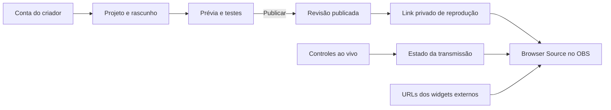

# qorpStreamer — especificação da primeira versão comercial

Data da pesquisa: 16/11/2026. Base de código auditada: `5e05ba9`.

Status: proposta para orientar a construção. Os requisitos abaixo descrevem o produto desejado, salvo quando identificados como recursos existentes. Nenhuma integração, conta, cobrança ou infraestrutura foi ativada nesta etapa.

## 1. Direção do produto

O qorpStreamer será um estúdio de overlays para criadores individuais brasileiros que usam OBS. A promessa é permitir que o criador configure a identidade do canal, prepare cenas, posicione seus widgets externos e publique uma transmissão consistente, com seu trabalho salvo na conta.

Decisões expressas pelo usuário:

- Público inicial de criadores individuais brasileiros que usam OBS.
- Hospedagem da aplicação na Vercel.
- Suporte a widgets externos de vários provedores. LivePix é um exemplo, não o centro da plataforma.
- Acesso recuperável e projetos vinculados ao usuário.
- Stripe como base dos futuros planos de monetização, operado por empresa registrada no Brasil (cartão recorrente e Pix avulso).
- Identidade qorp na aplicação, com refinamento visual contido. Xaxinim é um perfil/kit do produto.
- Supabase Auth + Postgres como fornecedor de conta e banco de dados.
- Lançamento como beta gratuito, sem cartão; plano Pro pago ativado depois do piloto e da medição de custos.
- Streamlabs como primeiro provedor de widget externo a validar na etapa 0.
- Lixeira de 30 dias para projetos excluídos; contas sem plano pago mantêm seus projetos dentro dos limites do plano gratuito.

### Origem do projeto, licença e créditos

O qorpStreamer é um fork do **Overlay Studio**, criado por Abhay Raghuwanshi (KazeKit): [abhayraghuwanshi/overlay-studio](https://github.com/abhayraghuwanshi/overlay-studio). A maior parte da base atual do editor, dos templates, dos widgets e do player vem desse projeto. Os créditos devem aparecer:

- no `README.md`, logo no início: "qorpStreamer é um fork do [Overlay Studio](https://github.com/abhayraghuwanshi/overlay-studio), de Abhay Raghuwanshi, distribuído sob AGPL-3.0";
- no rodapé da homepage e na tela **Sobre** do estúdio, com o mesmo texto e o link;
- em um arquivo `NOTICE.md`, listando o projeto original, o autor, a licença e o que foi modificado pela Qorp.

**Licença.** O projeto original passou a ser distribuído sob **GNU AGPL-3.0** (commit `736f107` do original), depois do ponto em que este fork foi criado. O repositório do qorpStreamer ainda não tem `LICENSE`. Antes de qualquer lançamento público é preciso:

1. Trazer do original o `LICENSE` (AGPL-3.0) e manter os avisos de copyright existentes.
2. Manter o qorpStreamer sob AGPL-3.0, já que é uma obra derivada. **Decisão do usuário: o produto segue na AGPL-3.0, com o repositório público.** Usar a versão anterior à licença não é uma alternativa: sem licença, o código do original fica com todos os direitos reservados ao autor.
3. Seguir a política de marca do original (`TRADEMARKS.md`): usar nome, logo e domínio próprios, não se apresentar como versão oficial e não usar "Overlay Studio" ou "KazeKit" como nome. Dizer que é "um fork do Overlay Studio" com link é permitido. O rebranding para qorp já foi feito; falta tirar "overlay studio" das palavras-chave de `seo.config.js`.

**O que a AGPL muda no negócio:**

- Quem usa o qorpStreamer hospedado tem direito ao código-fonte da versão que está rodando, inclusive as modificações da Qorp. O estúdio precisa de um link visível **Código-fonte** apontando para o repositório público na versão publicada.
- Isso inclui o código de contas, publicação e cobrança. Segredos (chaves do Stripe, do Supabase, tokens) ficam fora do código, em variáveis de ambiente, como já é a regra.
- **O diferencial comercial não pode depender de código fechado.** O que o Pro vende é o serviço: hospedagem confiável, armazenamento, histórico, suporte e kits premium. Qualquer pessoa pode rodar a própria cópia, como já pode fazer com o original.
- **Repositório público:** `Peterson047/overlay-studio` precisa ser público antes do site entrar no ar, e cada deploy em produção deve corresponder a um commit publicado nele.
- A licença comercial que o autor do original oferece fica como opção futura, caso o modelo de negócio mude.
- A arte dos kits premium (imagens, ilustrações, fontes) pode ter licença própria, separada do código, se ficar em arquivos de conteúdo e não for parte do programa. Confirmar esse ponto com assessoria jurídica antes de vender kits premium.

A vantagem a validar é a combinação de personalização simples, liberdade para usar serviços existentes e confiança durante a live. Isso é uma hipótese de produto, ainda sem validação de demanda ou disposição a pagar.

## 2. O que existe e o que falta

| Área | Estado verificado no código | Resultado necessário |
| --- | --- | --- |
| Editor e kits | Camadas, textos, imagens, molduras, fundos, biblioteca e cenas já existem | Tornar a configuração consistente, com desfazer/refazer e controles claros |
| Metas | `goal` e `liquidgoal` usam valores editados manualmente | Identificar a origem e adicionar widgets externos |
| Twitch | Existe implementação de chat e alguns eventos por IRC | Expor limites e estados reais, validar operação com o serviço |
| Projetos | Sala identificada por `room`, sem proprietário autenticado | Conta, projeto privado e autorização em cada operação |
| Reprodução | Link OBS usa o mesmo `room` que a edição | Credencial exclusiva de reprodução, revogável e sem escrita |
| Publicação | Alterações do editor chegam ao mesmo documento lido pelo OBS | Separar rascunho, versão publicada e controles ao vivo |
| Persistência | Vercel Functions + Upstash, versões e escrita atômica | Recuperação entre dispositivos, alterações pendentes e restauração |
| Arquivos | Imagens podem ir em base64 dentro do JSON do layout | Biblioteca de mídia com armazenamento próprio |
| Comercial | Não há contas, planos ou cobrança | Conta independente da assinatura, planos e Stripe |

Pontos de inspeção: [acesso por sala](/home/peterson/Documentos/GitHub/overlay-studio/src/config.js:33), [API de leitura/escrita](/home/peterson/Documentos/GitHub/overlay-studio/api/layout.js:100), [configuração das metas](/home/peterson/Documentos/GitHub/overlay-studio/src/components/ElementEditor.jsx:1114), [renderização da meta](/home/peterson/Documentos/GitHub/overlay-studio/src/components/ElementRenderer.jsx:1385), [sincronização](/home/peterson/Documentos/GitHub/overlay-studio/src/components/OverlayLayout.jsx:1370), [Twitch](/home/peterson/Documentos/GitHub/overlay-studio/src/live/twitchChat.js:1).

O problema de acesso é concreto: conhecer o identificador atual permite consultar e modificar a sala pela API. Uma conta deve ser proprietária de cada novo projeto, e o link do OBS deve conceder apenas reprodução.

## 3. Jornada principal

1. **Conhecer.** Ver kits reais e uma demonstração identificada, em português.
2. **Criar conta.** Entrar, confirmar o e-mail e criar um projeto recuperável.
3. **Configurar o canal.** Informar nome, logo e cores uma vez, com ajustes por cena quando necessário.
4. **Escolher o kit.** Começar com início, gameplay, conversa, intervalo e encerramento.
5. **Adicionar widgets.** Colar uma URL do provedor, definir tamanho/posição e testar a compatibilidade.
6. **Preparar.** Editar o rascunho e visualizar o resultado sem alterar a transmissão publicada.
7. **Publicar no OBS.** Receber link privado, dimensões, instruções e uma prévia da saída.
8. **Operar.** Trocar cenas do overlay, controlar timers e identificar problemas em um painel simples.
9. **Voltar.** Entrar em qualquer computador e continuar do projeto salvo, inclusive após recuperar a senha.

O OBS documenta fontes de navegador por URL, dimensões e opções de recarga/visibilidade. Esses parâmetros devem fazer parte da instalação orientada. Câmera, jogo e captura de tela continuam sendo fontes configuradas no OBS. [Fonte: OBS Browser Source](https://obsproject.com/kb/browser-source).

## 4. Organização das telas e linguagem visual

| Tela | Ação principal | Conteúdo essencial |
| --- | --- | --- |
| Meus projetos | Abrir ou criar projeto | Miniatura, nome, última alteração e publicação |
| Estúdio | Preparar a próxima publicação | Cenas à esquerda, canvas central, propriedades do item selecionado à direita |
| Widgets | Adicionar e reutilizar uma fonte | Nome, provedor, URL protegida, compatibilidade e instâncias nas cenas |
| Publicação | Conferir e publicar | Diferenças pendentes, prévia, link OBS e restauração |
| Ao vivo | Operar a saída publicada | Cenas publicadas, timers, conexão e botões grandes |
| Conta e plano | Recuperar acesso e administrar assinatura | E-mail, senha, sessões, plano, faturamento e suporte |

Widgets, publicação e operação podem ser áreas do mesmo projeto. Não exigem vários dashboards independentes.

Preservar a base qorp já presente na homepage: grafite `#151714`, texto claro `#f0f0e9`, coral `#ff7956` e lima `#d7f77b`. Usar acentos para ações e estados. O kit Xaxinim mantém sua paleta de entardecer, rosa, pêssego e lavanda dentro das cenas.

Priorizar canvas amplo, poucos níveis de navegação, rótulos em português e ações principais com altura proposta de 48 px. Usar estado textual junto da cor, foco de teclado visível e propriedades progressivas. O painel ao vivo deve funcionar no celular; a edição completa terá desktop como referência inicial. Validar a interface em 1366×768 e o painel ao vivo em 390 px de largura.

## 5. Widgets externos como capacidade central

### Tipos de conteúdo

| Tipo | Origem dos dados | Personalização no qorp |
| --- | --- | --- |
| Elemento nativo estático | Texto, mídia e configuração do projeto | Aparência completa |
| Meta manual | Valor informado pelo criador | Aparência e valor, com indicação de atualização manual |
| Widget externo por URL | Serviço escolhido pelo criador | Posição, tamanho, recorte, visibilidade e comportamento validado |
| Widget nativo conectado, futuro | API/eventos autorizados de um provedor | Visual qorp alimentado por dados externos |

A documentação do Streamlabs trata a URL do widget como um endereço usado pelo software de transmissão. Isso não comprova incorporação em qualquer site. [Fonte: URLs de widgets do Streamlabs](https://support.streamlabs.com/hc/en-us/articles/41706358816667-How-to-Locate-and-Use-Streamlabs-Widget-URLs).

### Fluxo proposto

1. Escolher **Adicionar widget externo**.
2. Informar nome e colar a URL específica de exibição fornecida pelo serviço.
3. Identificar o provedor quando possível. URLs de página de doação, dashboard ou perfil recebem orientação apropriada.
4. Definir viewport do widget, dimensões na cena e ajuste por escala ou recorte. Redimensionar o contêiner não deve mudar silenciosamente o layout interno.
5. Abrir a prévia e confirmar visualmente. Testar também no OBS antes de marcar o provedor como validado.
6. Escolher as cenas que usarão a mesma fonte e como ela se comporta quando ocultada.
7. Salvar a fonte no projeto. Cópias nas cenas referenciam a mesma configuração, permitindo trocar a URL uma vez.

### Contrato de compatibilidade

O catálogo deve distinguir **validado**, **não verificado** e **não incorporável**. Começar a validação pelo Streamlabs (decisão do usuário), mantendo a opção de URL personalizada. LivePix e StreamElements entram na sequência, depois que a matriz estiver aprovada com o Streamlabs. Nenhum provedor foi validado com uma URL privada real nesta pesquisa.

Uma página pode impedir iframe usando `X-Frame-Options` ou CSP `frame-ancestors`. A política de mesma origem também limita a leitura e alteração do conteúdo interno. Portanto, o qorp não deve prometer aplicar suas cores, ler a meta ou controlar eventos de qualquer URL. [Fontes: bloqueio de frames](https://developer.mozilla.org/en-US/docs/Web/HTTP/Reference/Headers/X-Frame-Options), [CSP](https://developer.mozilla.org/en-US/docs/Web/HTTP/Reference/Headers/Content-Security-Policy/frame-ancestors), [mesma origem](https://developer.mozilla.org/en-US/docs/Web/Security/Defenses/Same-origin_policy).

Para fontes não incorporáveis, oferecer instalação como Browser Source separado no OBS, com instruções de posição e dimensões. Esse caminho deve ser apresentado como fonte externa ao canvas. Não contornar bloqueios do provedor por proxy.

Requisitos de implementação:

- Aceitar HTTPS e validar protocolo/host. Bloquear endereços locais e esquemas executáveis. URLs personalizadas permanecem não verificadas até teste.
- Isolar conteúdo externo da sessão do editor. Definir permissões de iframe por necessidade comprovada, com origem separada para execução quando necessário.
- Não fazer requisições arbitrárias do servidor a URLs coladas. Qualquer diagnóstico remoto futuro precisa de validação de destino e redirecionamentos.
- Ocultar a URL na interface por padrão e removê-la de analytics, logs, capturas de diagnóstico e compartilhamento de templates.
- Reconhecer o limite técnico: o navegador que reproduz um iframe precisa receber sua URL. O link OBS é privado e não deve dar acesso à conta ou a operações de edição.
- Não considerar `iframe.onload` uma confirmação de funcionamento. Sem cooperação do provedor, o conteúdo pode estar vazio ou mostrar login sem o qorp conseguir inspecioná-lo.
- Prévia de widgets de alerta/áudio descarregada por padrão. Abrir somente por ação explícita; oferecer prévia silenciosa apenas quando houver mecanismo de silenciamento validado com o provedor.
- Manter uma única instância global para alertas reutilizados quando o provedor permitir. Documentar diferenças entre manter ativo e recarregar ao trocar de cena.

Matriz de validação por provedor: URL correta, ausência de login no OBS, frames permitidos, transparência, áudio, fonte oculta, troca de cena, recarga, rede interrompida e reconexão. Registrar data e versões testadas.

Testes disparados no serviço externo podem aparecer também na instância aberta no OBS. O estúdio deve explicar esse alcance antes do teste; separar rascunho não isola eventos produzidos pelo provedor. [Exemplo documentado: testes de alertas do Streamlabs](https://support.streamlabs.com/hc/en-us/articles/52499995174299-Setting-up-Your-Streamlabs-Alerts).

### Evolução para dados nativos

Integrações nativas serão avaliadas separadamente. A LivePix, por exemplo, documenta OAuth2 para contas de terceiros, consulta de recursos e webhooks. A pesquisa não confirmou endpoint de metas, assinatura criptográfica do webhook ou renovação de autorização de terceiros. Isso exige prova técnica antes de prometer uma meta qorp automática. [Fonte: API oficial LivePix](https://docs.livepix.gg/api).

Essa evolução não bloqueia a versão baseada em widgets externos. O catálogo não deve sugerir atualização automática para uma meta manual.

## 6. Conta, recuperação e propriedade dos projetos

Recomendação inicial: conta qorp com e-mail confirmado e senha, recuperação por e-mail e sessão persistente. Login social pode ser acrescentado depois, vinculado ao mesmo usuário. A conta de um provedor de widgets não será requisito para acessar o qorp.

Regras do produto:

- Cada projeto pertence a um `user_id` estável. Alterar e-mail ou plano não muda essa identidade.
- O painel lista os projetos da conta. O servidor verifica propriedade em leitura, alteração, upload, publicação, exclusão e cobrança.
- A sessão expirada abre a reautenticação preservando as alterações locais pendentes. A restauração exige o mesmo usuário e projeto.
- Mostrar **Salvando**, **Salvo na conta**, **Salvo neste dispositivo**, **Sem conexão** e **Falha ao salvar**, conforme o estado real.
- Persistir temporariamente alterações pendentes por usuário/projeto no dispositivo e sincronizar após reconexão. Conflitos entre abas/dispositivos oferecem comparação ou cópia recuperável.
- Ao trocar de conta, suspender a fila e as conexões anteriores. Uma sessão de outro usuário nunca envia as alterações pendentes da conta anterior. Cada gravação leva revisão de base e identificador de operação para lidar com conflito e repetição.
- Recuperar senha mantém todos os projetos. Troca de e-mail exige verificação e reautenticação adequada.
- Oferecer duplicação, exportação do projeto e lixeira recuperável por 30 dias. Depois desse prazo o projeto e as mídias exclusivas dele são removidos definitivamente.
- A assinatura controla recursos disponíveis. Cancelamento ou falha de pagamento não apagam projetos nem impedem login, consulta e exportação.

Decisão técnica: Supabase Auth e Postgres concentram autenticação e dados persistentes em um serviço gerenciado, mantendo frontend e APIs da aplicação na Vercel. Há suporte documentado a recuperação de senha e políticas por usuário no banco. O envio de e-mails precisa de SMTP de produção configurado e validado. [Fontes: autenticação](https://supabase.com/docs/guides/auth/passwords), [isolamento por linha](https://supabase.com/docs/guides/database/postgres/row-level-security), [SMTP](https://supabase.com/docs/guides/auth/auth-smtp).

Usar autenticação gerenciada evita implementar armazenamento de senhas no projeto. Políticas no banco complementam a autorização nas APIs; credenciais administrativas nunca chegam ao navegador.

## 7. Rascunho, publicação e saída OBS

O autosave grava o rascunho. **Publicar** cria uma revisão imutável e muda o ponteiro da saída de forma atômica. O OBS mantém a revisão anterior enquanto a próxima é carregada. **Restaurar publicação** volta a uma revisão anterior sem apagar o rascunho.

A revisão fixa a versão da configuração das fontes externas e as referências de mídia. Trocar URL, viewport ou permissões de uma fonte no rascunho só altera a saída após publicar. Evitar duas instâncias de áudio ativas durante a troca de revisão.

Publicar/restaurar também reconcilia o estado ao vivo: preservar cena e timers apenas quando compatíveis com o destino. Se a cena ativa deixou de existir, usar a cena inicial definida. Reiniciar estados incompatíveis sem repetir alertas ou transições antigas.

Publicação não controla os dados que mudam dentro de um widget externo. O provedor continua atualizando esse conteúdo independentemente das revisões do qorp.

A primeira versão terá uma saída principal por projeto, com cena do overlay escolhida pelo painel ao vivo. Essa troca não troca automaticamente as fontes de câmera/jogo nem a cena nativa do OBS. Links fixos por cena e controle remoto do OBS podem ser evoluções posteriores.

O link de reprodução deve usar token aleatório forte, com hash armazenado no servidor, escopo exclusivo de leitura e possibilidade de revogação. Não expor rascunhos, biblioteca privada, dados de cobrança ou credenciais administrativas no payload de reprodução. Comandos ao vivo exigem a sessão autenticada do criador. Permitir gerar um novo token, atualizar o OBS e então revogar o antigo, além de revogação imediata em caso de exposição.

Compartilhar template é outra operação: gera uma cópia sanitizada, sem tokens, URLs privadas de widgets ou dados da conta. Serviços existentes também distinguem configurações de tema e URLs operacionais privadas. [Fontes: temas do Streamlabs](https://support.streamlabs.com/hc/en-us/articles/25763343552795-What-Are-Widget-Themes-and-How-to-Use-Them), [saídas e alertas do StreamElements](https://docs.streamelements.com/selive/guides/overlays-and-alerts).

Em perda temporária de conexão, manter a última cena carregada e sinalizar o problema no painel do criador. A disponibilidade de iframes externos permanece dependente de cada provedor. Uma abertura a frio sem dados não deve exibir valores demonstrativos como se fossem reais.

Revogação explícita ou resposta 401/403 desmonta as fontes e interrompe a reprodução. Meta proposta: detectar revogação em até 15 segundos com conexão ativa, além de negar imediatamente novas leituras na API. Isso não apaga conteúdo já entregue a um cliente completamente offline nem invalida a URL original de um provedor externo; essa última revogação depende do próprio serviço.

## 8. Stripe e futuros planos

Stripe é a decisão de provedor de pagamento. O lançamento será um **beta gratuito**, sem exigir cartão. A integração Stripe é construída e testada em modo teste durante o beta; o plano **Pro** pago só é ativado em produção depois do piloto, da medição de custo por criador e da definição de preços e limites.

Proposta de integração: Stripe Checkout hospedado para contratar uma assinatura e Customer Portal para administrar pagamento, faturas e cancelamento. Conta qorp, cliente Stripe e assinatura são entidades distintas. O servidor associa `stripe_customer_id` ao usuário autenticado. [Fontes: Checkout de assinaturas](https://docs.stripe.com/payments/checkout/build-subscriptions), [Customer Portal](https://docs.stripe.com/customer-management).

Criar uma tabela de planos com capacidades e limites versionados, por exemplo projetos ativos, armazenamento e acesso a kits. O produto consulta permissões efetivas da conta em vez de espalhar comparações com nomes de planos pela interface. Valores, nomes comerciais e limites ainda precisam de validação.

Regras para cobrança:

- Criar sessões de Checkout no servidor, escolhendo preços de um catálogo permitido. O navegador não define proprietário, valor ou plano efetivo.
- Ativar benefícios com estado confirmado da assinatura/pagamento. A página de sucesso é apenas apresentação e pode mostrar **Confirmando pagamento**.
- Verificar assinatura dos webhooks, persistir eventos recebidos, processar com idempotência e reconciliar com o estado atual do Stripe quando necessário.
- Tratar entregas repetidas, atrasadas e fora de ordem, evitando conceder duas assinaturas ou regredir o acesso por evento antigo.
- Criar sessões do portal somente para o cliente Stripe da conta autenticada.
- Separar produtos, preços, chaves e webhooks de teste e produção.

O Stripe documenta o ciclo de assinaturas e atualização de acesso por eventos. A política de uso do qorp precisa transformar esses estados em comportamento visível. [Fontes: webhooks de assinaturas](https://docs.stripe.com/billing/subscriptions/webhooks), [recepção de webhooks](https://docs.stripe.com/webhooks).

| Situação | Política proposta para o qorp |
| --- | --- |
| Fase gratuita inicial | Acesso conforme plano interno inicial, sem exigir cartão |
| Pagamento confirmado e assinatura habilitada | Liberar capacidades contratadas |
| Cancelamento agendado | Preservar benefícios até o fim do período contratado |
| Primeira contratação pendente ou falhou | Manter os recursos iniciais, sem liberar benefícios da compra não confirmada |
| Renovação em atraso de uma assinatura existente | Avisar e manter o Pro por 7 dias de carência enquanto o Stripe tenta cobrar de novo |
| Assinatura encerrada | Preservar conta e projetos; aplicar os limites do plano disponível |
| Limite excedido após downgrade | Permitir abrir/exportar; bloquear novas ações excedentes sem excluir conteúdo |

A carência, o downgrade e o reembolso estão propostos abaixo. Não prometer hospedagem paga ilimitada após cancelamento.

### Formas de pagamento no Brasil

O público brasileiro prefere Pix, mas o Stripe tem uma limitação que afeta o desenho dos planos:

- **Contas Stripe brasileiras aceitam Pix só para pagamentos avulsos.** O Pix recorrente (Pix Automático) não está disponível para empresas domiciliadas no Brasil.
- **Empresas fora do Brasil podem cobrar Pix recorrente de clientes brasileiros.** Nesse caso a compra é internacional: o cliente paga 3,5% de IOF (ou a empresa absorve) e o Ebanx aparece como recebedor no extrato.
- Cartão de crédito funciona para assinatura recorrente nos dois casos.

[Fonte: Pix no Stripe](https://docs.stripe.com/payments/pix)

Decisão do usuário: a empresa que opera o Stripe é registrada no Brasil. Por isso:

| Plano | Forma de pagamento | Como funciona |
| --- | --- | --- |
| Pro mensal | Cartão | Assinatura recorrente pelo Stripe Billing |
| Pro anual | Cartão | Assinatura recorrente anual |
| Pro anual | Pix | Pagamento avulso que libera 12 meses de Pro, sem renovação automática. Avisar 15 e 3 dias antes de vencer, com link para pagar de novo |

O Pro por Pix avulso usa o mesmo catálogo de capacidades. Ele só difere na origem do direito de uso: um período pago com data de fim, não uma assinatura. A tabela de carência e downgrade vale igual quando esse período termina.

### Reembolso

- **Direito de arrependimento:** reembolso integral se o criador pedir em até 7 dias após a primeira contratação, como prevê o Código de Defesa do Consumidor (art. 49) para compras pela internet. Vale para cartão e Pix.
- **Depois de 7 dias:** sem reembolso proporcional. O cancelamento interrompe as próximas cobranças e o Pro continua até o fim do período pago.
- **Renovações:** o arrependimento de 7 dias vale para a primeira contratação. Para renovação anual, avisar por e-mail 15 dias antes e aceitar cancelamento com reembolso integral em até 7 dias depois da cobrança, como cortesia para evitar contestação.
- **Falha do serviço:** se uma falha do qorp derrubar a saída OBS durante lives, o suporte pode conceder reembolso parcial ou crédito, decidido caso a caso.
- **Reembolso faz o downgrade na hora**, com as mesmas regras de preservação de conteúdo.
- O Stripe permite reembolsar Pix em até 90 dias. Contestações de Pix (MED) não podem ser contestadas pelo vendedor, o que reforça a política de reembolso fácil no início.

Revisar a política e os termos com assessoria jurídica antes de ativar o Pro.

### Planos propostos

Proposta para validar no piloto. Os números são o ponto de partida para medir custo, não valores finais.

| Capacidade | Gratuito | Pro |
| --- | --- | --- |
| Projetos ativos | 2 | 15 |
| Cenas por projeto | 6 (um kit completo) | Ilimitadas |
| Widgets externos | Ilimitados | Ilimitados |
| Armazenamento de mídia | 250 MB | 5 GB |
| Tamanho máximo por arquivo | 10 MB | 50 MB |
| Kits | Kits base | Kits base + kits premium (ex.: Xaxinim) |
| Histórico de publicações para restaurar | Últimas 5 | Últimas 50 |
| Links OBS ativos por projeto | 1 | 3 (ex.: um por computador) |
| Lixeira | 30 dias | 30 dias |
| Selo qorp na saída | Nenhum | Nenhum |

Critérios desta divisão:

- **Widgets externos não têm limite.** Eles são o centro do produto e quase não custam ao qorp, porque o provedor hospeda o conteúdo.
- **O Pro cobra pelo que gera custo ou é diferencial:** armazenamento, histórico, kits premium e vários projetos.
- **A saída do plano gratuito não leva selo nem marca d'água.** Um selo na live afastaria o público inicial, que ainda está validando o produto.
- **Preço de referência a testar:** entre R$ 19 e R$ 29 por mês, com desconto no plano anual. Confirmar depois de medir o custo por criador ativo (seção 10) e conversar com os criadores do piloto.

**Durante o beta:** todos começam no Gratuito. Os criadores do piloto recebem o Pro sem custo durante o beta, como um benefício interno, sem passar pelo Stripe. Isso permite medir o custo real de um uso Pro. No fim do beta, quem recebeu o benefício é avisado com 30 dias de antecedência antes de voltar ao Gratuito ou assinar.

### Carência e downgrade

- **Renovação falhou (`past_due`):** o Pro continua por 7 dias. Avisar por e-mail e no estúdio, com um link para o Customer Portal. Depois dos 7 dias sem pagamento, a conta passa ao Gratuito.
- **Primeira compra pendente (`incomplete`):** não libera o Pro. A conta continua no Gratuito.
- **Cancelamento:** o Pro vale até o fim do período pago. Depois disso a conta passa ao Gratuito.
- **O link OBS nunca para por causa do plano.** Após o downgrade, a saída continua mostrando a última revisão publicada. Só novas publicações respeitam os limites do Gratuito. Uma live nunca cai por motivo de cobrança.
- **Projetos acima do limite:** o criador escolhe quais 2 continuam ativos. Os outros ficam **somente leitura**: dá para abrir, exportar e excluir, mas não editar nem publicar. Se o criador não escolher, ficam ativos os 2 editados mais recentemente. A saída OBS publicada dos projetos somente leitura continua funcionando.
- **Mídia acima do limite:** nada é apagado. Novos uploads ficam bloqueados até o uso ficar abaixo do limite ou a conta voltar ao Pro.
- **Histórico:** as revisões além das 5 mais recentes deixam de aparecer para restauração. Elas só são removidas 30 dias depois, para que voltar ao Pro recupere o histórico.
- **Kits premium já aplicados** continuam nos projetos. Não é possível aplicar um kit premium em um projeto novo.
- **Aviso prévio:** qualquer restrição é comunicada com a data em que acontece. Nenhuma mudança é aplicada durante uma live ativa: se o player estiver conectado, a troca de plano espera a próxima vez que ele ficar sem uso.

A primeira compra pendente (`incomplete`) e uma renovação em atraso (`past_due`) exigem políticas diferentes. Avaliações gratuitas não entram no escopo até a oferta ser definida. [Fonte: ciclo de assinaturas Stripe](https://docs.stripe.com/billing/subscriptions/overview).

Cobrança por uso, marketplace, divisão de receitas e Stripe Connect ficam fora do primeiro recorte. A cobrança do qorp é independente das doações recebidas pelos widgets externos.

### Backup e exclusão de conta

**Backup:**

- **Banco:** usar os backups diários gerenciados do Supabase, guardados por pelo menos 7 dias. Confirmar a retenção do plano Supabase contratado antes do lançamento e avaliar a restauração para um ponto no tempo (PITR) quando houver criadores pagantes.
- **Mídia (Vercel Blob):** não depende de backup do provedor. Os arquivos são imutáveis (um arquivo novo nunca sobrescreve outro), e a exclusão passa pela lixeira de 30 dias. Uma cópia semanal para outro armazenamento fica para quando houver criadores pagantes.
- **Teste de restauração:** restaurar um backup em um ambiente separado uma vez por mês e antes do lançamento. Isso já é critério de pronto (seção 13).
- **A lixeira é a proteção contra erro do usuário. O backup é a proteção contra falha do sistema.** A restauração de backup não é oferecida como recurso para o criador.

**Exclusão de conta:**

1. O criador pede a exclusão na área **Conta e plano**, confirmando a senha.
2. Na hora: a assinatura Stripe é cancelada sem cobrança futura, todos os links OBS são revogados e as sessões são encerradas.
3. A conta fica 30 dias em exclusão pendente. Nesse prazo, entrar de novo permite desfazer a exclusão. Os links OBS não voltam sozinhos: é preciso gerar novos.
4. Depois de 30 dias: projetos, revisões, mídias, fontes externas e perfil são apagados definitivamente. Os dados apagados saem dos backups conforme eles expiram.
5. Registros de cobrança necessários por obrigação fiscal ficam guardados no Stripe e em uma tabela mínima, sem o conteúdo dos projetos.

Antes de excluir, oferecer a exportação de todos os projetos. A exportação e a exclusão atendem aos direitos de acesso e eliminação da LGPD. Revisar os textos com assessoria jurídica antes do lançamento.

## 9. Escopo recomendado para 1.0

| Compromisso de lançamento | Limite inicial |
| --- | --- |
| Conta e projetos recuperáveis | Um proprietário por projeto, sem equipes |
| Identidade de canal e kit completo | Poucos kits bem resolvidos, começando pela base existente |
| Editor confiável | Cenas, camadas, propriedades, desfazer/refazer, autosave e recuperação |
| Widgets externos | URL personalizada, presets validados, reutilização e guia OBS alternativo |
| Mídia | Upload, biblioteca reutilizável e limites claros |
| Publicação | Prévia, revisão publicada, link estável e restauração |
| Operação | Troca de cenas do overlay, timers e estado de conexão |
| Comercial | Beta gratuito; modelo de planos (Gratuito/Pro) e Stripe em modo teste, ativação do Pro separada |
| Suporte | Instalação guiada, erros acionáveis e diagnóstico sem segredos |

Adiar integrações nativas de doações, novos conectores de chat, IA local, editor de código, equipes, marketplace e automações complexas. Recursos experimentais existentes podem permanecer fora da navegação comercial até terem uma promessa verificável.

## 10. Arquitetura proposta na Vercel

Preservar React/Vite e os componentes úteis do editor. Separar gradualmente projetos, editor, player OBS, fontes externas, mídia, publicação e cobrança. O tamanho atual de `OverlayLayout.jsx` justifica extrair responsabilidades durante essas entregas, sem uma reescrita integral.

| Responsabilidade | Proposta |
| --- | --- |
| Frontend e player | Vite/React hospedados na Vercel, com carregamento separado |
| API | Vercel Functions com autenticação e autorização por recurso |
| Conta e dados duráveis | Auth gerenciado + Postgres, proposta inicial Supabase |
| Arquivos | Vercel Blob com upload autorizado, cotas e controle de referências |
| Sincronização | API versionada; avaliar polling e WebSocket em prova de carga |
| Redis existente | Transição do legado e cache quando necessário, sem duplicar a fonte de verdade |
| Cobrança | Stripe Checkout, Customer Portal e webhook na Vercel |

Vercel oferece Blob e integração com bancos gerenciados pelo Marketplace. Usar serviços de dados não muda a escolha da Vercel como hospedagem da aplicação. [Fonte: Vercel Storage](https://vercel.com/docs/storage).

A documentação atual permite WebSockets em Vercel Functions, com disponibilidade geral anunciada em 20/10/2026. As conexões continuam sujeitas à duração da Function e precisam reconectar; o estado deve sobreviver a mudanças de instância. Portanto, não basear o desenho na antiga premissa de que a Vercel não suporta WebSockets. [Fontes: WebSockets](https://vercel.com/docs/functions/websockets), [anúncio](https://vercel.com/changelog/websocket-support-is-now-generally-available).

Começar com o contrato de versões e recuperação de estado; escolher o transporte após medir latência e custo. WebSocket sozinho não resolve distribuição de eventos entre instâncias. Não adicionar outro serviço de realtime sem uma necessidade demonstrada.

Modelo mínimo: usuário, perfil do canal, projeto com rascunho versionado, revisão publicada, fonte externa, instância de fonte na cena, arquivo, credencial de reprodução, estado ao vivo, plano, assinatura e evento de cobrança processado. Cenas e elementos podem permanecer em JSON versionado dentro do projeto; não precisam virar dezenas de tabelas.

Arquivos saem do JSON base64. Cada mídia tem dono, tamanho, tipo e referências. Publicações antigas precisam continuar encontrando suas mídias durante o período de restauração. Exportação de template remove fontes privadas; backup pessoal, quando incluir segredos, exige fluxo explícito e tratamento separado.

Mídias de rascunho são privadas. O player acessa somente arquivos referenciados pela revisão publicada autorizada, por leitura mediada ou URLs temporárias. Conhecer o ID do arquivo não concede leitura. Assets de catálogo deliberadamente públicos são uma categoria separada. A validade de URLs temporárias deve ser definida junto da política de revogação, sem prometer recolher arquivos já baixados.

Medir custo por criador ativo: Functions, consultas ao banco, armazenamento, transferência de mídia, e-mails e processamento de cobrança. No polling, `saídas × segundos de uso ÷ intervalo` estima as consultas do player. Exemplo ilustrativo: 100 saídas abertas por 4 horas a cada 10 segundos produzem 144.000 consultas, sem contar editores, gravações ou tentativas extras. Isso é dimensionamento, não previsão de demanda ou preço.

**Custo de mídia por criador (Vercel Blob, região iad1, preços consultados em 16/11/2026):**

| Item | Preço | Exemplo | Custo/mês |
| --- | --- | --- | --- |
| Armazenamento | US$ 0,023 por GB/mês | Pro usando os 5 GB inteiros | ~US$ 0,12 |
| Transferência (Blob Data Transfer) | US$ 0,05 por GB | 200 MB de mídia por live × 20 lives = 4 GB | ~US$ 0,20 |
| Uploads e operações | US$ 5,00 por milhão (avançadas) | Uso normal do editor | Centavos |

Mesmo um criador Pro no limite fica abaixo de US$ 1/mês em arquivos. O limite de 5 GB é um teto; o uso médio esperado é bem menor. A estimativa de 200 MB por live é uma hipótese a medir no piloto.

Pontos que mudam essa conta:

- **Plano da Vercel:** o Hobby não permite uso comercial e inclui só 1 GB de Blob. O qorp precisa do plano Pro da Vercel (cerca de US$ 20/mês com crédito de uso incluído), um custo fixo independente do número de criadores.
- **Entrega de mídia privada:** passar cada arquivo por uma Function cobra Fast Data Transfer, cerca de 3 vezes mais cara que a Blob Data Transfer. Preferir URLs temporárias assinadas, com cache no navegador do OBS, para que o player baixe direto do Blob.
- **Vídeo:** fundos animados em vídeo pesam muito mais que imagens. O limite de 50 MB por arquivo no Pro existe por isso, e o consumo de vídeo no piloto decide se os 5 GB se mantêm.

[Fonte: preços do Vercel Blob](https://vercel.com/docs/vercel-blob/usage-and-pricing)

## 11. Migração do que já foi criado

Conhecer uma sala antiga não prova autoria. Não implementar uma regra de atribuir a sala ao primeiro usuário que entrar com aquele link.

Oferecer importação explícita de uma cópia do projeto/biblioteca que o usuário possui, com prévia e seleção. A cópia recebe novo projeto autenticado e novo token OBS. Não importar automaticamente todos os dados locais para a primeira conta aberta em um computador compartilhado.

Validar formato, versão, limites e mídias da importação. Atribuir o proprietário pela sessão, renovar IDs internos e reiniciar estado ao vivo. Importar como rascunho, com proteção contra duplicação por nova tentativa. Não redirecionar o link legado para o novo projeto privado.

URLs de widgets e futuras credenciais não migram em templates públicos. O modelo antigo não fornece prova suficiente para conceder acesso exclusivo retroativo; casos existentes de titularidade precisam de verificação específica antes de transferir ou desativar uma saída.

Planejar encerramento das gravações anônimas e do canvas compartilhado `default`, com backup do legado e comunicação de migração. Preservar exportações recuperáveis antes de qualquer limpeza. A migração é uma entrega própria, sem apagar dados durante a implantação de contas.

Projetos autenticados usam rotas/namespace protegidos, sem permitir alterações pela API legada. Apenas acrescentar um dono ao JSON antigo manteria a possibilidade de escrita anônima.

## 12. Ordem de construção

| Etapa | Entrega | Critério para avançar |
| --- | --- | --- |
| 0 — Validar contratos | Protótipo de widget externo no navegador/OBS, fluxo de acesso e política de publicação | Matriz de provedores testada e decisões fundamentais registradas |
| 1 — Rede de testes | Testes automatizados cobrindo o que existe hoje, rodando no CI a cada mudança | Os fluxos críticos atuais têm teste, e o CI bloqueia mudanças que os quebram |
| 2 — Design system e refinamento da interface | Tokens, componentes base, catálogo e migração das telas atuais, sem mudar comportamento | Todas as telas atuais usam os componentes do design system e os testes da etapa 1 continuam passando |
| 3 — Conta e projetos | Login, recuperação, propriedade, dashboard e importação do legado | Recuperar o projeto em outro dispositivo e impedir acesso de outra conta |
| 4 — Persistência e mídia | Autosave recuperável, conflitos, upload e exportação | Perda de rede/aba não descarta silenciosamente trabalho confirmado ou pendente |
| 5 — Publicação e player | Revisões, token de leitura, operação e restauração | Editar rascunho não muda a live; revogar token bloqueia o acesso correspondente |
| 6 — Widgets e experiência | Fontes externas reutilizáveis, testes, kits e interface em português | Criador configura e usa widgets validados no OBS sem editar código |
| 7 — Planos e Stripe | Catálogo interno, Checkout, Portal e webhooks em teste | Contratação, repetição de evento, cancelamento e downgrade corretos |
| 8 — Piloto | Criadores do público inicial em transmissões reais | Critérios abaixo medidos e falhas bloqueadoras corrigidas |

As etapas são dependências, não estimativas de prazo. Widgets são investigados na etapa 0 para que limitações de terceiros não sejam descobertas depois de redesenhar o editor. As etapas 1 e 2 vêm antes de contas e publicação porque essas mudanças mexem no núcleo do editor e do player: a rede de testes impede que elas quebrem o que já funciona, e o design system evita construir as telas novas (projetos, conta, publicação, ao vivo) com o visual antigo para depois refazer.

### Etapa 1 — Rede de testes

Objetivo: congelar o comportamento atual em testes automatizados antes de mudar o sistema. Hoje o projeto não tem nenhum teste; só lint e build (`npm run check`). Esta etapa não muda funcionalidade, só acrescenta testes e o CI.

**Ferramentas:**

- **Vitest** para testes de unidade e de API (integra com o Vite já usado).
- **React Testing Library** para componentes.
- **Playwright** para testes de ponta a ponta no navegador e comparação visual por captura de tela.
- **GitHub Actions** rodando lint, testes, build e Playwright em cada push e pull request.

**O que cobrir, por prioridade:**

| Prioridade | Área | Testes |
| --- | --- | --- |
| 1 | Formato do layout | Carregar, salvar e migrar o JSON de layout; layouts antigos continuam abrindo |
| 1 | API (`api/layout.js`) | Leitura, escrita, versão, escrita atômica, limites de tamanho e erros, com Redis simulado |
| 1 | Sincronização editor → player | Uma mudança no editor chega ao player; o player não mostra valores demonstrativos como reais |
| 1 | Player OBS | A rota do player renderiza cada cena com fundo transparente e sem a interface do editor |
| 2 | Editor | Adicionar, mover, redimensionar, duplicar e apagar elemento; camadas; troca de cena; aplicar tema e kit |
| 2 | Widgets | Meta (cálculo do progresso), timers, relógio e pomodoro com tempo controlado no teste |
| 2 | Twitch | Parser de mensagens e eventos do IRC com mensagens gravadas, sem conectar à Twitch |
| 3 | Templates | Cada um dos templates da galeria abre sem erro e gera uma captura de referência (regressão visual) |
| 3 | Homepage | Carrega, links principais funcionam, estúdio abre sob demanda |

**Regras:**

- Testes não acessam serviços reais (Twitch, Upstash, Streamlabs). Tudo externo é simulado ou gravado.
- As capturas de referência ficam no repositório. Uma mudança visual intencional atualiza a referência no mesmo pull request, para ficar visível na revisão.
- Teste instável é corrigido ou removido na hora; não fica sendo ignorado.
- A partir desta etapa, toda correção de bug vem com o teste que reproduz o bug.

**Critério de saída:** todas as linhas de prioridade 1 e 2 cobertas, templates com captura de referência, e o CI obrigatório para juntar mudanças na `main`.

### Etapa 2 — Design system e refinamento da interface

Objetivo: dar à interface do qorp uma base visual única e fácil de manter, e refinar as telas atuais sem mudar o que elas fazem. A interface hoje é montada direto com classes Tailwind espalhadas pelos componentes, o que torna cada ajuste visual um trabalho manual em vários arquivos.

**Separação importante:** o design system é da **interface do estúdio** (botões, painéis, formulários, homepage). Os **temas e kits do overlay** (`src/theme/`, Xaxinim e os outros) são conteúdo que aparece na live e continuam independentes. Um não deve herdar as cores do outro.

**1. Tokens**, definidos uma vez no `@theme` do Tailwind 4 e usados por nome:

- **Cor:** a base qorp da seção 4 (grafite `#151714`, texto `#f0f0e9`, coral `#ff7956`, lima `#d7f77b`), mais superfícies, bordas, texto secundário e estados (sucesso, aviso, erro, informação). Todo par de texto e fundo com contraste AA verificado.
- **Tipografia:** uma família, escala de 5 ou 6 tamanhos, pesos definidos.
- **Espaçamento:** escala base 4 px.
- **Raio, sombra, borda e movimento:** poucos valores fixos, com `prefers-reduced-motion` respeitado.
- **Tamanhos de controle:** 32 px nos painéis densos do editor e 48 px nas ações principais e no painel ao vivo, como define a seção 4.

**2. Componentes base** em `src/ui/`:

Botão, botão de ícone, campo de texto, campo numérico, seletor, slider, alternador, seletor de cor, abas, painel lateral, seção recolhível, modal, menu, dica (tooltip), aviso (toast), indicador de estado (Salvando, Salvo na conta, Sem conexão…), estado vazio e esqueleto de carregamento.

Cada componente traz estados de foco, desabilitado, carregando e erro, navegação por teclado e rótulos em português.

**3. Catálogo:** uma rota interna (`/?ui`) que mostra todos os tokens e componentes com seus estados. Serve de referência para desenvolver e de alvo para a comparação visual do Playwright. Não adicionar Storybook enquanto o catálogo simples bastar.

**4. Migração das telas atuais**, uma por vez, cada uma num pull request:

1. Painel de propriedades (`ElementEditor.jsx`), que é o maior e mais usado.
2. Camadas e cenas (`LayersPanel.jsx`, `LayerStrip.jsx`).
3. Galeria de templates, temas e fundos.
4. Configurações e ajuda.
5. Homepage.

Em cada tela: trocar os controles pelos componentes do design system, padronizar espaçamentos e textos, revisar a hierarquia visual e manter o comportamento igual. Os testes da etapa 1 garantem que nada quebrou; as capturas mudam de propósito e são revisadas.

**5. Regras de uso:**

- Tela nova só usa componentes de `src/ui/`. Classes Tailwind soltas ficam para o layout da página, não para recriar um botão.
- Cor e tamanho sempre por token, nunca valor solto.
- Mudar um token muda o produto todo; por isso cada mudança de token passa pela comparação visual.

**Critério de saída:** catálogo publicado, as cinco telas migradas, contraste e teclado verificados nas telas migradas, interface validada em 1366×768 e 390 px de largura, e os testes da etapa 1 passando.

### Protocolo da etapa 0 — Streamlabs

Objetivo: descobrir se os widgets do Streamlabs funcionam dentro do player do qorp no OBS, antes de construir o fluxo de widgets externos.

**Preparação:**

- Uma conta Streamlabs de teste, ligada a um canal Twitch de teste. Nunca usar URLs de widget de um canal real em código, issue ou log.
- Um protótipo mínimo do player: uma página na Vercel (domínio de preview) que exibe um iframe com a URL colada, em canvas 1920×1080 transparente. Sem conta e sem banco; a URL fica só no navegador local.
- OBS na versão estável atual, numa máquina de referência registrada (sistema, CPU, GPU, versão do OBS).

**Widgets a testar, em ordem:**

1. **Alert Box** (alertas com som e animação). É o mais crítico: tem áudio e eventos.
2. **Goal** (meta de doações, seguidores ou inscritos).
3. **Chat Box**.
4. **Event List**.

**Para cada widget, em duas montagens:**

- **A:** a URL do widget direto como Browser Source no OBS. É a referência de como deveria funcionar.
- **B:** o player do qorp como Browser Source, com o widget dentro do iframe.

**Testes (marcar passou / falhou / parcial em A e B):**

| # | Teste | Como verificar |
| --- | --- | --- |
| 1 | Carrega sem login | O widget aparece sem pedir autenticação |
| 2 | Iframe permitido | Não há bloqueio por `X-Frame-Options` ou `frame-ancestors` (ver console) |
| 3 | Transparência | O fundo do widget fica transparente sobre a cena |
| 4 | Evento de teste | Disparar alerta de teste pelo painel do Streamlabs e ver aparecer em B |
| 5 | Áudio | O som toca uma vez, pelo áudio do Browser Source no OBS |
| 6 | Sem áudio duplicado | Com A e B abertos ao mesmo tempo, registrar se os dois tocam (esperado) e garantir que B sozinho toca uma vez |
| 7 | Fonte oculta | Esconder a fonte no OBS e disparar alerta: registrar se fica na fila ou se perde |
| 8 | Troca de cena | Trocar a cena do overlay no qorp: o widget continua sem recarregar e sem perder eventos |
| 9 | Recarga | Recarregar o Browser Source: o widget volta em quanto tempo |
| 10 | Rede caída | Desligar a rede por 30 segundos e religar: o widget reconecta sozinho e recebe novos eventos |
| 11 | Escala | Widget desenhado para 800×600 exibido em 400×300: escala correta, sem corte inesperado |
| 12 | Sessão longa | Deixar 4 horas rodando e medir CPU e memória do OBS no início e no fim |

**Registro:** uma linha por widget e montagem, com data, versão do OBS, máquina e resultado de cada teste. Guardar em `docs/validacao/streamlabs.md`, sem nenhuma URL ou token.

**Critério de saída:**

- **Validado:** Alert Box e Goal passam em todos os testes na montagem B. Os testes 7 e 8 podem ser parciais se o comportamento for igual ao da montagem A.
- **Não incorporável:** o teste 2 falha. O Streamlabs passa a usar o caminho de Browser Source separado no OBS, e o fluxo de widgets do editor é redesenhado em torno dessa limitação antes da etapa 3.
- **Parcial:** documentar a limitação, decidir com o usuário se ela é aceitável e repetir a validação com LivePix e StreamElements antes de seguir.

## 13. Critérios de produto pronto

Critérios propostos para o piloto, ainda não resultados obtidos:

- Recuperar senha e acessar os mesmos projetos em outro navegador.
- Uma segunda conta não consegue ler/escrever projetos, arquivos, fontes ou cobrança da primeira, mesmo conhecendo seus IDs.
- Um link OBS não autoriza edição nem acesso ao dashboard. Revogação nega novas leituras e interrompe o player conectado em até 15 segundos.
- Editar e salvar o rascunho preserva a configuração publicada, inclusive URLs e viewport dos widgets. Testes de eventos externos seguem o alcance documentado pelo provedor.
- Publicar e restaurar mantêm a URL OBS estável. Remover a cena ativa ou um timer na nova revisão não produz tela vazia nem repete eventos antigos.
- Um widget validado funciona durante troca de cena, recarga e reconexão, com áudio sem duplicação. URLs não suportadas recebem uma alternativa compreensível.
- Interromper a rede, expirar a sessão ou fechar uma aba com alterações pendentes permite recuperação identificável, sem sobrescrever trabalho mais novo silenciosamente.
- A saída permanece operável em uma sessão de OBS de quatro horas, incluindo reconexões. Medir CPU/memória em máquina de referência definida no piloto.
- Meta inicial de latência do comando até o player: p95 de até 2 segundos em rede estável. Excluir eventos internos de terceiros dessa meta e medir o transporte antes de assumir atendimento.
- Checkout abandonado não concede benefícios; evento repetido não duplica ações; cancelamento e downgrade preservam conta e conteúdo.
- Backup restaurado em ambiente separado recupera um projeto e sua publicação com mídias disponíveis.

Métricas iniciais: tempo até primeira publicação funcionando no OBS, conclusão do cadastro/recuperação, taxa de sucesso dos widgets por provedor, falhas de salvamento, retorno após uma semana e solicitações de suporte por criador ativo. Proposta de pesquisa: observar cinco criadores realizando a jornada sem condução passo a passo; usar os resultados para revisar o fluxo antes de ampliar a oferta.

## 14. Decisões ainda abertas

| Decisão | Encaminhamento |
| --- | --- |
| Provedores além do Streamlabs | Validar URLs autorizadas reais de LivePix e StreamElements após o Streamlabs; não publicar compatibilidade só com base na documentação |
| Números dos planos | Proposta Gratuito/Pro e preço de referência na seção 8; validar no piloto com o custo medido |
| Licença e créditos | Feito: `LICENSE`, `NOTICE.md`, créditos no README, links na homepage e palavras-chave do SEO. Falta a tela **Sobre** no estúdio, com créditos e link do código-fonte |
| Kits premium sob AGPL | Confirmar com assessoria jurídica se a arte dos kits premium pode ter licença separada do código |
| Textos legais | Revisar política de reembolso, termos de uso e política de privacidade com assessoria jurídica antes de ativar o Pro |
| Transporte de sincronização | Medir polling e WebSocket na Vercel com a mesma carga e requisitos |

O próximo trabalho de construção deve começar pela prova de compatibilidade dos widgets e pela fundação de contas/projetos. Novos temas e recursos decorativos passam a seguir esse fluxo de produto.
